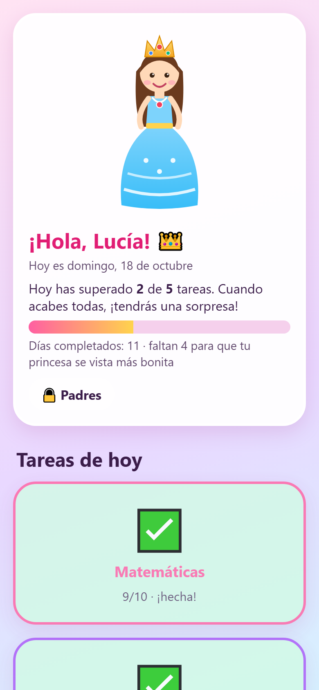
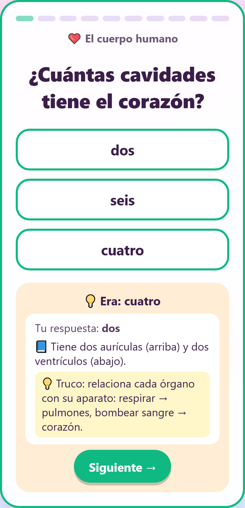
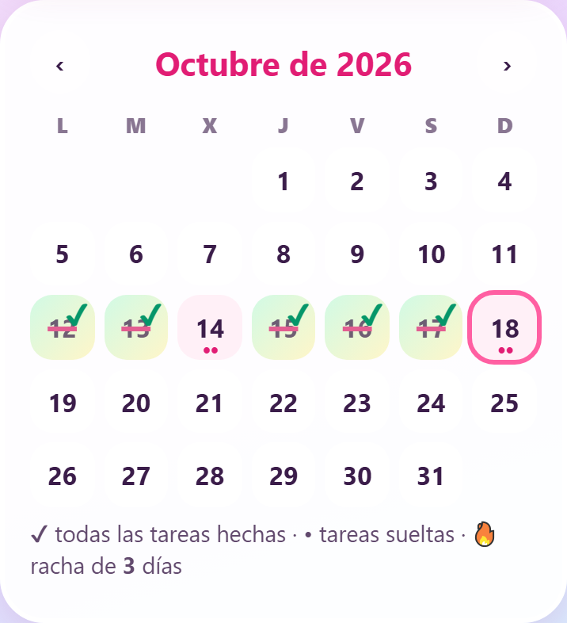
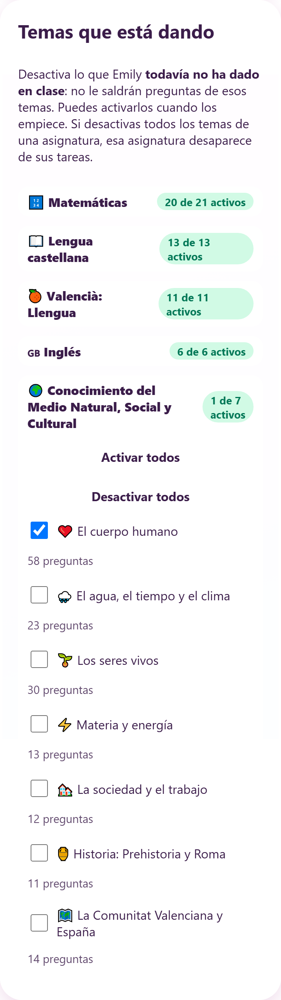

# Repaso 4.º de Primaria 👑 — ejercicios y deberes gratis, sin internet

**App gratuita y de código abierto para que los niños de 9-10 años repasen 4.º de Primaria en casa**: matemáticas, lengua, valenciano, inglés y conocimiento del medio. Funciona en tablet, móvil u ordenador, **sin cuentas, sin anuncios y sin conexión a internet** una vez instalada.

Cada día hay una tarea corta por asignatura (10 preguntas, sin cronómetro). Si el niño falla, la app le explica **por qué** y le da un **truco** para la próxima vez. Los padres ven los resultados y eligen qué temas está dando el colegio.

<p align="center">
  
  
</p>

> **Demo:** `https://code-ops-lab.github.io/repaso-4-primaria/` — ábrela en el navegador del móvil o la tablet e instálala (ver [Instalar](#instalar-en-la-tablet-o-el-móvil)).

## ¿Para quién es?

Para familias que buscan **ejercicios de repaso de 4.º de Primaria** y quieren que sus hijos practiquen a diario sin pantallas llenas de anuncios ni suscripciones. Está pensada para el **currículo de la Comunitat Valenciana** (incluye valenciano), pero sirve también para repasar con el temario general de Primaria en España.

## Qué incluye

| Asignatura | Temas |
|---|---|
| 🔢 **Matemáticas** | Sumas, restas, **multiplicaciones**, **divisiones** (por una y por dos cifras), cálculo mental, multiplicar y dividir por 10, 100 y 1.000, operaciones combinadas, **fracciones**, **decimales**, números grandes y con letras, números romanos, medidas y hora, geometría, **problemas**. Las cuentas se generan solas: nunca se acaban. |
| 📖 **Lengua castellana** | Ortografía, tildes (agudas, llanas y esdrújulas), diptongos e hiatos, sustantivo, adjetivo y verbo, la oración, tiempos verbales, vocabulario y frases hechas, **comprensión lectora**. |
| 🍊 **Valencià: Llengua** | Ortografia, síl·labes i accentuació, gramàtica, sinònims i antònims, vocabulari, comprensió lectora. |
| 🇬🇧 **Inglés** | Vocabulary, grammar (to be, has got, can, there is/are…), hora, días y números, preposiciones. |
| 🌍 **Conocimiento del Medio** | El cuerpo humano, los seres vivos, el agua y el clima, materia y energía, la sociedad, historia (Prehistoria y Roma), la Comunitat Valenciana y España. |

Casi **380 preguntas** originales con explicación, repartidas en bloques por tema, y **17 generadores** de ejercicios de matemáticas.

## Cómo funciona

- **Tarea diaria por asignatura**: 10 preguntas, **sin tiempo ni presión**. Se supera con 8 aciertos; si no, se repite con preguntas nuevas.
- **Explicaciones al fallar**: la respuesta correcta, una explicación breve, un truco corto y, en las cuentas, qué ha podido pasar («has sumado en vez de multiplicar», «revisa las llevadas»…).
- **Dificultad adaptativa**: los temas suben o bajan de nivel según cómo le va.
- **Recompensa**: cuando termina todas las tareas aparece el cartel «¡Ya puedes jugar!». Una princesa en la pantalla de inicio crece con los días completados.
- **Calendario** con los días tachados y la racha de días seguidos.
- **Zona de padres** (con PIN): resultados de la última semana, hora de cada intento, fallos y qué preguntas falló; **elegir los temas que está dando** (por ejemplo, desactivar la división por dos cifras si aún no la ha visto); reiniciar las tareas del día; **subir un PDF** para crear ejercicios nuevos del mismo estilo; importar paquetes de preguntas.

<p align="center">
  
  
</p>

## Privacidad

- **Sin registro, sin servidor, sin anuncios, sin rastreadores.**
- Todo el progreso se guarda **solo en el dispositivo** (en el navegador). No se envía nada a ningún sitio.
- Los PDF se leen en el propio dispositivo.

## Instalar en la tablet o el móvil

1. Abre la demo con **Chrome** (Android) o **Safari** (iPad/iPhone), con wifi, y espera a que cargue.
2. Android: menú ⋮ → **«Instalar app»** (o «Añadir a pantalla de inicio» → «Instalar»). iPad/iPhone: Compartir → **«Añadir a pantalla de inicio»**.
3. Ábrela desde el icono. Desde ese momento funciona sin internet.

> La instalación necesita que la dirección empiece por `https://`. No uses el modo incógnito ni borres los datos del navegador: ahí se guarda el progreso.

## Ejecutarla en tu ordenador

Necesitas [Node.js](https://nodejs.org) 18 o superior.

```bash
git clone https://github.com/code-ops-lab/repaso-4-primaria.git
cd repaso-4-primaria
npm install
npm run dev        # desarrollo: http://localhost:5173
npm run build      # versión final en /dist (se puede subir a cualquier hosting estático)
```

Para publicarla en tu propio sitio: **GitHub Pages** (`npm run deploy`, ver la [guía técnica](docs/GUIA-TECNICA.md#publicar)), Netlify, Cloudflare Pages o cualquier hosting de archivos estáticos.

## Añadir tus propios ejercicios

- **Desde la zona de padres → «Ejercicios a partir de un PDF»**: sube una ficha en PDF. Si tiene operaciones, crea operaciones nuevas del mismo estilo; si tiene preguntas con opciones, listas de palabras o un texto, prepara preguntas que tú revisas antes de añadir.
- **Desde un archivo `.json`**: formato y ejemplo en la [guía técnica](docs/GUIA-TECNICA.md#formato-de-un-paquete-de-preguntas) y en [`ejemplos/ejercicios-ejemplo.json`](ejemplos/ejercicios-ejemplo.json).

¿Has escrito preguntas para otro curso o asignatura? Las contribuciones son bienvenidas: mira [CONTRIBUTING.md](CONTRIBUTING.md).

## Aviso

Proyecto independiente y gratuito: **no está afiliado a ninguna editorial ni a ninguna administración educativa**. Las preguntas son originales y se han escrito tomando como referencia los temas que aparecen en documentos públicos de saberes de 4.º de Primaria de la Comunitat Valenciana; no sustituyen al libro de texto ni al criterio del profesorado. Conviene revisarlas con el material del colegio de tu hijo o hija.

## Tecnología

React 18 · Vite · PWA (service worker, funciona sin conexión) · [pdf.js](https://mozilla.github.io/pdf.js/) para leer PDF en el dispositivo. Sin backend.

Estructura y decisiones en la [guía técnica](docs/GUIA-TECNICA.md).

## Licencia

[MIT](LICENSE). Úsala, cópiala y adáptala libremente.

---

<sub>**Palabras clave:** ejercicios 4.º de primaria · repaso 4.º primaria · fichas de repaso cuarto de primaria · deberes 4.º primaria · app educativa gratis para niños · juegos educativos primaria · multiplicaciones y divisiones 4.º primaria · fracciones y decimales · problemas de matemáticas 4.º primaria · comprensión lectora 4.º primaria · ortografía y tildes · valenciano 4.º primaria · inglés primaria · conocimiento del medio 4.º primaria · app sin internet para niños · repaso vuelta al cole · tablet · Comunitat Valenciana.</sub>
